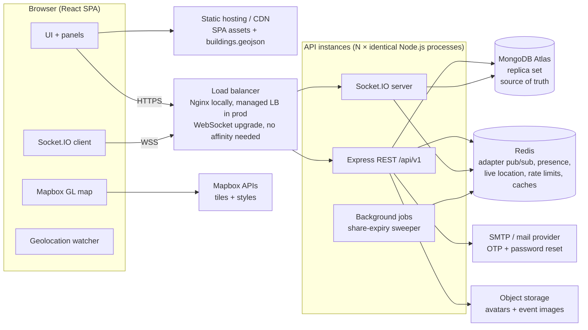
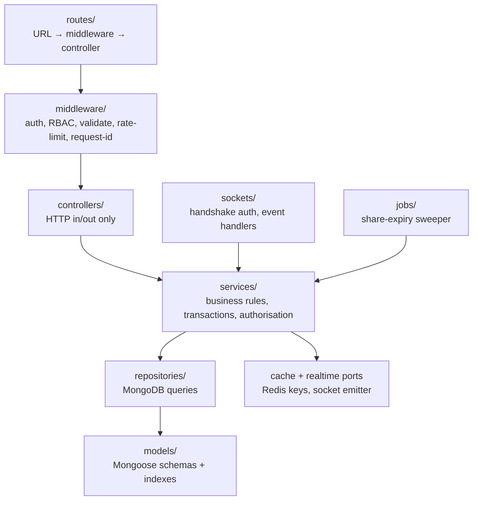
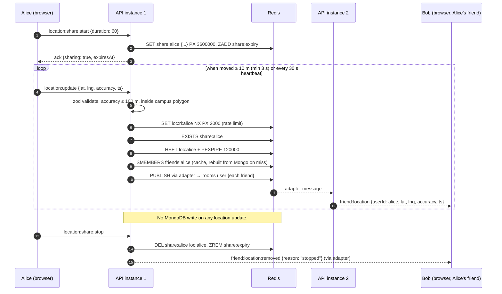
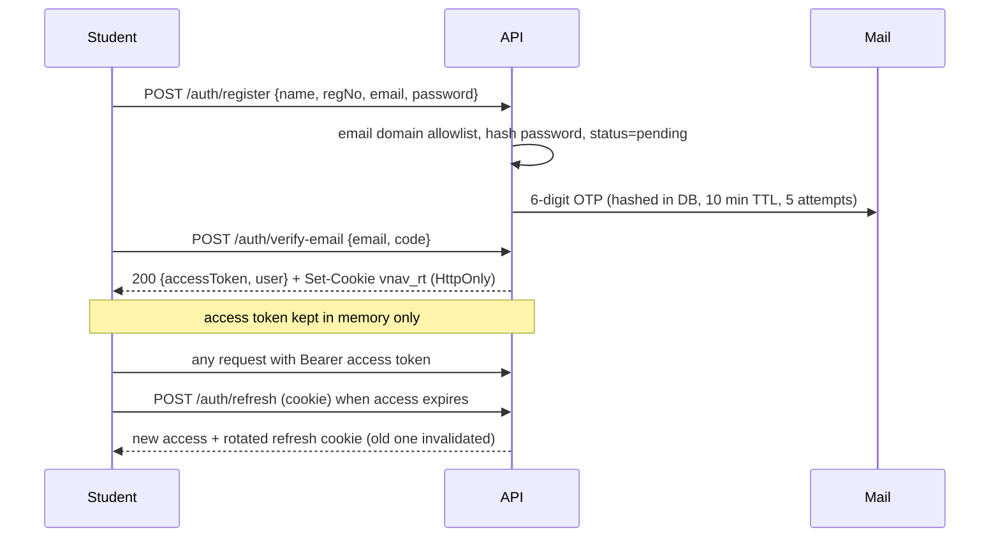

# V-Nav Architecture

Status: **Approved design (Phase 1).** Nothing here is implemented yet unless [DEVELOPMENT_PROGRESS.md](../DEVELOPMENT_PROGRESS.md) says so.

Related: [Database schema](DATABASE_SCHEMA.md) · [REST API](API_DOCUMENTATION.md) · [Socket events](SOCKET_EVENTS.md) · [Security](SECURITY.md) · [Scalability](SCALABILITY.md) · [Deployment](DEPLOYMENT.md) · [Load testing](LOAD_TESTING.md)

---

## 1. Goals and constraints

| Goal | Concrete target |
|---|---|
| Users | 2,000+ registered VIT Chennai students |
| Concurrency | 500 concurrent authenticated Socket.IO connections (initial benchmark) |
| Location | 200+ users sharing simultaneously, friend-only delivery |
| Privacy | Location reaches only accepted, non-blocked friends while sharing is on; no location history |
| Scale-out | Any number of identical API instances; no correctness depending on one process |
| Team size | Maintainable by one or two student developers → a **modular monolith**, not microservices |

---

## 2. System overview



**One deployable backend.** REST, Socket.IO and the small background jobs run in the same Node.js process. Every instance is identical and stateless; all cross-instance state lives in Redis (ephemeral) or MongoDB (durable). This keeps operations simple while still scaling horizontally. Splitting services out is only justified if measurements show one part (for example socket fan-out) needs independent scaling.

---

## 3. Key architectural decisions

Each decision states the problem it solves. Alternatives considered are listed so the reasoning can be challenged.

| # | Decision | Why | Rejected alternative |
|---|---|---|---|
| D1 | **Modular monolith** (Express + Socket.IO in one process, layered modules) | Small team, one deploy, shared auth and models. Horizontal scaling still works because the process is stateless. | Microservices: adds network hops, distributed auth, and ops cost with no measured need. |
| D2 | **MongoDB as the only durable store**, run as a replica set | Already in use; flexible documents fit profiles and events; replica set gives multi-document **transactions** (needed for friendships). | Postgres: a fine choice, but switching gives no product benefit here and costs a rewrite of working knowledge. |
| D3 | **Redis for everything ephemeral**: Socket.IO adapter, live location, sharing state, presence, rate limits, friend-set cache | Live location is high-frequency and must not be stored permanently. Redis TTLs give automatic expiry, stale detection and deletion for free. | Writing GPS points to MongoDB: hundreds of writes per second, creates a location history the brief forbids. |
| D4 | **No location in MongoDB, ever.** Only `users.lastSeenAt` (a timestamp, no coordinates). | Privacy by design. If Redis is lost, everyone simply appears not-sharing (**fail closed**). | Persisting last-known location: a stored location becomes a liability and a retention problem. |
| D5 | **WebSocket-only Socket.IO transport** (HTTP long-polling disabled) | Long-polling needs sticky sessions. On campus Wi-Fi most students share a few NAT IPs, so IP-hash stickiness would pin nearly everyone to one instance. WebSocket-only needs no affinity. | Polling + cookie-based stickiness: works, but adds LB config and fails silently if misconfigured. Revisit only if real users report blocked WebSockets. |
| D6 | **Server-authoritative sharing state** (`share:{userId}` in Redis) checked on **every** location update | The client UI cannot be trusted; "stop sharing" must take effect on the server immediately. | Client-only toggle (current code): a modified client can keep broadcasting. |
| D7 | **Authorise at delivery time** against a Redis friend-set cache that is **invalidated synchronously** on every friendship or block change | Fixes the current bug where an unfriended user keeps receiving updates until reconnect. | Caching friend IDs on the socket at connect time (current code). |
| D8 | **Friendships as two edge documents** (`{userId, friendId}` and the reverse) written in one transaction | Friend lists become a single indexed, paginated query; no unbounded arrays in user documents. | Arrays in `users` (current code): unbounded growth, non-atomic two-document updates. |
| D9 | **Short-lived access JWT (15 min, in memory) + rotating opaque refresh token (HttpOnly cookie, hashed in MongoDB)** | Limits XSS blast radius, enables real logout, session lists and "log out everywhere". | 7-day JWT in `localStorage` (current code). |
| D10 | **Student verification behind a `StudentVerifier` interface**; first implementation = institutional email OTP | A registration number proves nothing. Email OTP is verifiable today; a roster or SSO provider can be plugged in later without touching auth flows. | Trusting the registration number. |
| D11 | **Campus geofence**: positions outside the campus polygon are **not shared**; friends see "off campus" | A campus app has no reason to reveal a student's home or off-campus location. | Sharing anywhere: maximum privacy risk for no product value. |
| D12 | **TypeScript on the server, JavaScript on the client initially** *(default — awaiting your confirmation)* | Types catch auth and privacy mistakes where they matter most; converting the existing JSX client wholesale is high-churn. Client can migrate file by file later. | Full TS now / plain JS everywhere. |
| D13 | **Images re-encoded server-side with `sharp`** | Strips EXIF metadata (phone photos embed GPS coordinates), enforces dimensions, produces WebP. | Storing uploads as-is: leaks GPS, allows oversized files. |

---

## 4. Backend architecture

### 4.1 Layers



Rules:
- **Controllers** parse the validated request, call one service method, shape the response. No database calls.
- **Services** own business rules and authorisation decisions ("can A see B's event?"). They are the only layer that starts transactions and the only layer sockets call into. This means REST and Socket.IO enforce identical rules.
- **Repositories** wrap MongoDB queries so services stay testable and queries (with their indexes) live in one place.
- **Socket handlers** are thin, like controllers: validate payload → call a service → ack.

### 4.2 Folder structure

```
server/
  src/
    config/          env.ts (zod-validated, fail fast), db.ts, redis.ts, constants
    constants/       error codes, event categories, socket event names, roles
    models/          User, Session, VerificationCode, PasswordResetToken,
                     FriendRequest, Friendship, Block, Event, AuditLog
    repositories/    one per aggregate
    services/        auth, verification (StudentVerifier + EmailOtpVerifier),
                     session, user, friend, block, location, presence, event,
                     upload (StorageAdapter: local | s3), mail (MailTransport), audit
    controllers/     auth, user, friend, block, location, event, health
    routes/          v1 router composition
    middleware/      requestId, httpLogger, authenticate, requireRole,
                     validate(zodSchema), rateLimit, errorHandler, notFound
    validators/      zod schemas per route and per socket event
    sockets/         index (server + Redis adapter), auth handshake,
                     handlers/location.ts, handlers/presence.ts, emitter.ts
    jobs/            shareExpirySweeper.ts
    observability/   logger (pino + redaction), metrics (prom-client), tracing (OTel, opt-in)
    utils/           AppError, asyncHandler, crypto helpers, geo (point-in-polygon), cursor
    app.ts           builds the Express app (no listen) → importable by tests
    server.ts        HTTP server, Socket.IO, jobs, graceful shutdown
  test/              unit/, integration/ (Supertest + real Mongo/Redis), socket/
  scripts/           seed, sync-indexes, load-test user seeding
```

### 4.3 Request lifecycle

`requestId` → `pino-http` log → `helmet` → CORS allowlist → body limit (100 kB JSON) → route-level rate limit → `authenticate` (verify JWT, check session not revoked) → `requireRole` (where needed) → `validate(zod)` (strips unknown keys; blocks `$`-operator injection) → controller → service → response. Errors become `AppError` and are rendered by one handler as `{ error: { code, message, requestId } }`; 5xx details are logged, never returned.

### 4.4 Process lifecycle

Startup: validate env → connect MongoDB (pool 20, server selection timeout 5 s) → connect Redis (pub, sub, command clients) → sync indexes in dev only → start HTTP + Socket.IO → start jobs → `/ready` turns green.

Shutdown on `SIGTERM`/`SIGINT`: `/ready` returns 503 → stop accepting connections → tell sockets to reconnect elsewhere (`server:shutdown` then disconnect) → stop jobs → drain in-flight HTTP (10 s cap) → close Redis and MongoDB → exit 0. Hard exit after 20 s.

---

## 5. Frontend architecture

### 5.1 Principles

1. **The map is the app.** One Mapbox instance lives in the app shell for the whole session; routes render panels (desktop) or bottom sheets (mobile) on top of it. Navigating never recreates the map.
2. **High-frequency data bypasses React.** Friend locations arrive many times per second across friends. They go into a Zustand store that the map layer subscribes to **outside React** (`store.subscribe`) and flushes to a GeoJSON source at most once per animation frame. No component re-renders per location update.
3. **Server state via TanStack Query** (friends, requests, events, profile): caching, request de-duplication, pagination, retries and invalidation. Socket events invalidate or patch query caches.
4. **Client state via Zustand** (auth session, sharing status, UI panels, live locations).
5. **Route-level code splitting**: auth pages, events, profile and settings are lazy-loaded; Mapbox loads with the shell.

### 5.2 Folder structure

```
client/src/
  app/            App.jsx (providers + router only), router.jsx (lazy routes)
  layouts/        AppShell (map + floating nav + panel outlet), AuthLayout
  pages/          auth/*, MapHome, Friends, FindFriend, Events, EventDetail,
                  EventForm, Profile, Settings
  components/     ui/ (shadcn primitives), map/ (layers, popups, controls),
                  friends/, events/, profile/, feedback/ (skeletons, empty, error)
  hooks/          useGeolocationSharing, useMediaQuery, useDebouncedValue
  stores/         authStore, locationStore, uiStore
  services/       apiClient (fetch wrapper, refresh-on-401 single-flight),
                  auth, friends, events, users, location
  sockets/        socketClient (singleton), handlers → stores / query cache
  constants/      map config, routes, limits
  utils/          geo (distance, movement threshold), format, errors
  assets/
```

### 5.3 Routes

| Path | Purpose |
|---|---|
| `/login`, `/register`, `/verify-email`, `/forgot-password`, `/reset-password` | Auth flows (public) |
| `/` | Map home: you, friends, events, buildings |
| `/friends` | Friend list, incoming/outgoing requests, blocked users |
| `/friends/find` | Look up by friend code, send request |
| `/events` | Discover: list + filters, synced with map |
| `/events/new`, `/events/:id`, `/events/:id/edit` | Create, view, edit |
| `/profile`, `/settings` | Profile, privacy, sessions, location sharing |

Navigation labels follow the brief: V-Nav · Map · Find a Friend · Friends · Events · Add Event · Profile.

**Removed from the current app** (see audit §5): Heatmap, Explore, and the Navigation route planner. They have no working backing feature. Turn-by-turn routing is listed as **not yet implemented** in progress tracking rather than shown as a dead button.

### 5.4 Map layers

| Layer | Source | Rendering |
|---|---|---|
| Buildings | Static `campus-buildings.geojson` (OpenStreetMap, regenerated by `ops/osm/fetch-buildings.mjs`) | `fill-extrusion` + `symbol` labels; feature-state hover; click popup |
| Events | `GET /events/map?bbox&from&to` | GeoJSON source with `cluster: true`; `circle` + `symbol` layers |
| Friends | `locationStore` (vanilla Zustand) | Clustered GeoJSON source; `circle` + `symbol` initials and name; rAF-batched `setData`; dimmed after 60 s, dropped after 120 s |
| You | Local geolocation | One DOM marker + accuracy circle (single element, fine as DOM) |

Using layers instead of one DOM `Marker` per item keeps hundreds of points cheap; the current code creates a DOM node per friend and per event.

---

## 6. Location-sharing data flow



Revocation paths, all of which remove Alice from Bob's map immediately:

| Trigger | Server action |
|---|---|
| Alice stops sharing | Delete `share:` + `loc:` keys, emit `friend:location:removed` to friends |
| Timed sharing expires | Sweeper job claims the expiry with `ZREM` (exactly one instance wins), same as stop |
| Alice unfriends or blocks Bob | Transaction commits → `DEL friends:alice friends:bob` → emit removal to both → future updates skip Bob |
| Alice goes off campus | Update rejected with `OFF_CAMPUS`; friends get `removed {reason: "off_campus"}` once |
| Alice's app goes silent | `loc:alice` expires after 120 s; friends' clients also hide markers older than 120 s |
| Alice logs out / session revoked | `io.in("user:alice").disconnectSockets()` across instances; sharing cleared |

---

## 7. Authentication flow (summary)

Full detail and threat model in [SECURITY.md](SECURITY.md).



---

## 8. Open assumptions (need your confirmation)

| # | Assumption used in these docs | If you decide otherwise |
|---|---|---|
| Q1 | Allowed email domain: **`vitstudent.ac.in`** (configurable list) | Change `ALLOWED_EMAIL_DOMAINS` |
| Q2 | Mail: **Mailpit** (local SMTP inbox in Docker) for development; any SMTP provider in production via `SMTP_*` env | No code change, only config |
| Q3 | Building geometry from **OpenStreetMap** (ODbL, attribution on map); buildings missing from OSM are omitted, not invented. Campus geofence polygon from the OSM campus boundary. | You supply surveyed GeoJSON instead |
| Q4 | Existing MongoDB data is **test data and will be reset** | I write a migration script for `friends[]` → `friendships` instead |
| Q5 | Server in **TypeScript**, client stays JS | Adjust D12 |
| Q6 | Load testing with **Artillery** only (native Socket.IO engine plus HTTP), not k6 | k6 would need hand-written Socket.IO framing for socket scenarios |
