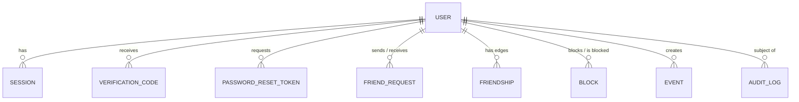

# V-Nav Database Schema

Status: **Approved design (Phase 1).**

MongoDB is the source of truth for all durable data. Redis holds only ephemeral state that is safe to lose (see §3). MongoDB must run as a **replica set** (Atlas always is; local Docker uses a single-node replica set) because friendship changes use multi-document transactions.

Conventions:
- All `_id` are ObjectIds. All timestamps are UTC `Date`. `createdAt`/`updatedAt` via Mongoose `timestamps`.
- No unbounded arrays in any document.
- Indexes are declared in the Mongoose schema; `autoIndex` is off in production and indexes are applied with `npm run db:indexes` during deploy.
- Every query in the repositories layer must be served by an index listed here. Index changes go through this file.

---

## 1. Entity relationships



---

## 2. Collections

### 2.1 `users`

| Field | Type | Notes |
|---|---|---|
| `name` | string, 2–60, trimmed | Display name |
| `email` | string, lowercase | Institutional email; domain must be in `ALLOWED_EMAIL_DOMAINS` |
| `regNo` | string, uppercase | Self-reported registration number, format-validated (e.g. `22BCE1234`). **Not proof of identity** until a roster verifier exists. |
| `passwordHash` | string | bcrypt cost 12. Never selected by default (`select: false`). |
| `role` | `student` \| `moderator` \| `admin` | Default `student` |
| `status` | `pending_verification` \| `active` \| `suspended` | Only `active` users can log in, use sockets or appear in lookups |
| `verification` | `{ method: 'email_otp', verifiedAt: Date }` | Which `StudentVerifier` verified the account |
| `friendCode` | string, `VNAV-XXXXX` | 5 chars from Crockford base32 (no `I L O U`), generated with `crypto.randomInt`. 32⁵ ≈ 33.5 M codes; collisions retried. |
| `avatar` | `{ key, url, updatedAt } \| null` | Object-storage key of re-encoded WebP |
| `privacy` | `{ showOnlineStatus: boolean, allowFriendRequests: boolean }` | Defaults `true`, `true` |
| `friendCount` | int ≥ 0 | Denormalised counter, changed only inside friendship transactions |
| `lastSeenAt` | Date \| null | Written once when a user's **last** socket disconnects. Timestamp only, **no coordinates**. |
| `passwordChangedAt` | Date | Used to reject access tokens issued before a password change |
| `deletedAt` | Date \| null | Set briefly during account deletion; the document is then hard-deleted |

Indexes:

| Index | Type | Serves |
|---|---|---|
| `{ email: 1 }` | unique | Login, registration duplicate check |
| `{ friendCode: 1 }` | unique | Friend-code lookup (hot path) |
| `{ regNo: 1 }` | unique, **partial** `{ status: 'active' }` | Prevents two verified accounts claiming one reg. number, while an unverified squatter cannot block the real student from registering |
| `{ createdAt: 1 }` | **TTL** 7 days, partial `{ status: 'pending_verification' }` | Abandoned unverified registrations delete themselves; no cleanup job needed |

### 2.2 `sessions`

One document per logged-in device. Holds the refresh token hash.

| Field | Type | Notes |
|---|---|---|
| `userId` | ObjectId | |
| `familyId` | string (UUID) | Constant across rotations of one login; used for reuse detection |
| `tokenHash` | string | SHA-256 of the current opaque refresh token (256-bit random). Plain token is never stored. |
| `previousTokenHash` | string \| null | Last rotated-out hash; presenting it again = **token reuse** → revoke the whole family |
| `userAgent` | string (truncated 200) | Shown in "active sessions" |
| `ipHash` | string | HMAC of IP; for abuse correlation without storing raw IPs |
| `lastUsedAt` | Date | |
| `expiresAt` | Date | Idle expiry: now + 30 days, extended on each refresh |
| `revokedAt` | Date \| null | Logout, logout-all, password change, reuse detection |

Indexes: `{ tokenHash: 1 }` unique (refresh lookup) · `{ previousTokenHash: 1 }` sparse (reuse detection) · `{ userId: 1, revokedAt: 1 }` (list / revoke all) · `{ expiresAt: 1 }` **TTL** `expireAfterSeconds: 0`.

### 2.3 `verification_codes`

| Field | Type | Notes |
|---|---|---|
| `userId` | ObjectId | |
| `purpose` | `email_verification` | Extensible |
| `codeHash` | string | HMAC-SHA256(server secret, code). 6-digit code never stored in plain text. |
| `attempts` | int | Locked after 5 wrong attempts |
| `expiresAt` | Date | now + 10 min |

Indexes: `{ userId: 1, purpose: 1 }` unique (one active code per purpose; resend replaces it) · `{ expiresAt: 1 }` **TTL**.

### 2.4 `password_reset_tokens`

`{ userId, tokenHash, expiresAt (30 min), usedAt }`. Indexes: `{ tokenHash: 1 }` unique · `{ expiresAt: 1 }` **TTL**. Using a token revokes all of the user's sessions.

### 2.5 `friend_requests`

Only **pending** requests are stored. Accept, reject and cancel delete the document (accept also creates friendships in the same transaction).

| Field | Type |
|---|---|
| `from` | ObjectId |
| `to` | ObjectId |
| `pairKey` | string: the two user ids sorted and joined with `:` |
| `createdAt` | Date |

Indexes:

| Index | Serves |
|---|---|
| `{ pairKey: 1 }` unique | At most **one pending request per pair, in either direction**. Prevents duplicates and crossing requests at the database level, even when both students tap "Add" at the same instant (the second insert fails; the retry finds the first request and accepts it). |
| `{ to: 1, createdAt: -1, _id: -1 }` | Incoming requests inbox, paginated (`_id` breaks timestamp ties) |
| `{ from: 1, createdAt: -1, _id: -1 }` | Outgoing requests, paginated |

Rules enforced in `FriendService.sendRequest` (inside a transaction):
1. Target exists, is `active`, and `privacy.allowFriendRequests` is true.
2. Not self.
3. No block in either direction.
4. Not already friends.
5. If the target has already sent a request to the sender, **accept it** instead of creating a crossing request.
6. Cap of 50 outgoing pending requests per user (spam guard).

### 2.6 `friendships`

Each friendship is **two edge documents**, created and deleted together in one transaction.

| Field | Type |
|---|---|
| `userId` | ObjectId (owner of this edge) |
| `friendId` | ObjectId |
| `since` | Date |

Indexes: `{ userId: 1, friendId: 1 }` unique (duplicate prevention, "are A and B friends?" point lookup) · `{ userId: 1, since: -1, _id: -1 }` (friend list, cursor pagination).

**Why two edges instead of one `{a, b}` pair document:** listing a user's friends becomes one equality query on an index prefix, sorted and paginated, instead of an `$or` across two fields that cannot share one sort. The cost is 2× storage on a small collection (2,000 users × ~50 friends × 2 ≈ 200 k tiny docs) — negligible.

Hard cap: 1,000 friends per user. Keeps the Redis friend set and event-visibility `$in` lists bounded.

### 2.7 `blocks`

| Field | Type |
|---|---|
| `blocker` | ObjectId |
| `blocked` | ObjectId |
| `createdAt` | Date |

Indexes: `{ blocker: 1, blocked: 1 }` unique · `{ blocker: 1, createdAt: -1, _id: -1 }` (my block list) · `{ blocked: 1 }` (check "has anyone I'm interacting with blocked me").

Blocking, in one transaction: insert block → delete both friendship edges (decrement both `friendCount`s) → delete pending requests in both directions. After commit: invalidate both friend-set caches and emit location/presence removal to both users.

### 2.8 `events`

| Field | Type | Notes |
|---|---|---|
| `creatorId` | ObjectId | |
| `title` | string, 3–100 | |
| `description` | string, ≤ 2,000 | Plain text; rendered as text, never HTML |
| `category` | enum | `academic`, `technical`, `cultural`, `sports`, `club`, `career`, `social`, `other` |
| `image` | `{ key, url } \| null` | Re-encoded WebP, EXIF stripped |
| `location` | GeoJSON `Point` `{ type: 'Point', coordinates: [lng, lat] }` | Must be inside the campus polygon |
| `venue` | `{ buildingId?: string, label: string }` | Building from the buildings layer, or free-text label |
| `startsAt` | Date | Brief's "date + start time" |
| `endsAt` | Date | Brief's "end time". `endsAt > startsAt`, max 14 days long |
| `visibility` | `campus` \| `friends` | |
| `status` | `active` \| `cancelled` | Cancel keeps the record for attendees; delete removes it |

Indexes:

| Index | Serves |
|---|---|
| `{ visibility: 1, endsAt: 1, startsAt: 1 }` | Campus-wide discovery: "upcoming or ongoing" = `endsAt ≥ now`, sorted by `startsAt` |
| `{ creatorId: 1, startsAt: -1 }` | "My events", and friends-only events via `creatorId: { $in: friendIds }` |
| `{ location: '2dsphere' }` | Map viewport (`$geoWithin` bbox) queries |
| `{ category: 1, startsAt: 1 }` | Category filter |

Visibility query (built only in `EventService`, never from client input):

```js
{
  status: 'active',
  endsAt: { $gte: from },
  startsAt: { $lte: to },
  $or: [
    { visibility: 'campus' },
    { visibility: 'friends', creatorId: { $in: [viewerId, ...friendIds] } }  // friendIds ≤ 1,000, from Redis cache
  ],
  creatorId: { $nin: blockedEitherWay }  // users in a block relationship with the viewer
}
```

Pagination is **cursor-based** on `(startsAt, _id)`; offset pagination is not offered because it degrades with depth and skips/duplicates rows while events are being created. Past events are not deleted automatically.

### 2.9 `audit_logs`

Security-relevant actions only: `login_success`, `login_failed`, `password_changed`, `password_reset`, `session_revoked`, `token_reuse_detected`, `user_blocked`, `role_changed`, `event_removed_by_moderator`, `account_deleted`.

`{ actorId, action, targetId?, ipHash, metadata (small, no secrets, no coordinates), createdAt }`. Indexes: `{ actorId: 1, createdAt: -1 }` · `{ action: 1, createdAt: -1 }` · `{ createdAt: 1 }` **TTL 180 days**.

---

## 3. Redis keys

Redis is ephemeral. Losing it must never corrupt data; at worst users appear offline / not sharing until they reconnect (**fail closed** for privacy).

| Key | Type | TTL | Purpose |
|---|---|---|---|
| `share:{userId}` | hash `{ startedAt, expiresAt? }` | timed: until expiry; open-ended: 12 h safety cap | Authoritative "is sharing" flag |
| `share:expiry` | sorted set, score = end time (expiry, or the 12 h cap for open-ended shares) | — | Sweeper (every 5 s on each instance) finds ended shares; the `ZREM` return value elects exactly one instance to notify friends |
| `loc:{userId}` | hash `{ lat, lng, acc, ts }` | 120 s, refreshed per update | Latest position. Expiry = stale detection + automatic deletion |
| `loc:off:{userId}` | string | 120 s | "Friends were already told this student left campus"; deleted by the next on-campus update |
| `loc:rl:{userId}` | string | 2 s | Location update rate limit (`SET NX PX`), shared across tabs and instances |
| `presence:{userId}` | hash `socketId → expiry time (ms)` | 90 s; each instance refreshes its own sockets every 30 s | Online while any entry is fresh. Add/remove run in Lua and drop stale entries, so a crashed instance's sockets stop counting within 90 s and the first/last tab is detected exactly once |
| `friends:{userId}` | set of friend IDs | 10 min | Delivery-time authorisation cache. **Deleted synchronously** after any friendship/block commit |
| `blocks:{userId}` | set of IDs blocked either way | 10 min | Event visibility and lookup filtering; deleted on block/unblock |
| `friends:gen:{userId}`, `blocks:gen:{userId}` | counter | 24 h | Bumped on every invalidation. A reader writes a freshly loaded set back only if the counter is unchanged (checked in Lua), so a read that started before an unfriend commits cannot re-cache the old list. Empty lists are cached as the marker member `_`. |
| `session:revoked:{sessionId}` | string | 15 min (access token lifetime) | Rejects still-valid access tokens of revoked sessions |
| `rl:{scope}:{key}` | counters | per limit window | HTTP rate limiting (`rate-limit-redis` store) |
| `login:fail:{email}` | counter | 15 min | Progressive account lockout |
| Socket.IO adapter channels (prefix `vnav`) | pub/sub | — | Cross-instance event delivery (`@socket.io/redis-adapter`), on two dedicated connections |

**Location is never written to MongoDB.** No key holds more than the latest point. There is no history to delete because none is kept.

---

## 4. Data retention

| Data | Where | Retention |
|---|---|---|
| Live location | Redis `loc:` | ≤ 120 s after last update; deleted immediately on stop / unfriend / block / logout |
| Sharing state | Redis `share:` | Until stopped, expired, or 12 h cap |
| Last seen time | `users.lastSeenAt` | Life of account; hidden from others if `showOnlineStatus` is false |
| Verification codes | MongoDB | 10 min (TTL) |
| Password reset tokens | MongoDB | 30 min (TTL) |
| Sessions | MongoDB | 30 days idle (TTL) |
| Audit logs | MongoDB | 180 days (TTL), no coordinates |
| Unverified accounts | MongoDB | Deleted after 7 days by cleanup job |
| Application logs | Log sink | Per host config; contain user IDs and request IDs, **never** coordinates, passwords, tokens, OTPs or emails |
| Account deletion | All | Hard-delete user, sessions, codes, requests, friendships (both edges, decrement counters), blocks, the user's events and images, Redis keys |

---

## 5. Connection settings

| Setting | Value | Reason |
|---|---|---|
| `maxPoolSize` | 20 per instance | 4 instances × 20 = 80 connections, well within Atlas M10's limit |
| `serverSelectionTimeoutMS` | 5,000 | Fail fast on startup and in `/ready` rather than hang |
| `socketTimeoutMS` | 30,000 | Kill stuck queries |
| Query `maxTimeMS` | 5,000 default in repositories | Bounds slow queries under load |
| `retryWrites` | true | Transient primary elections |
| Transactions | `readConcern: snapshot`, `writeConcern: majority` | Friendship consistency |
