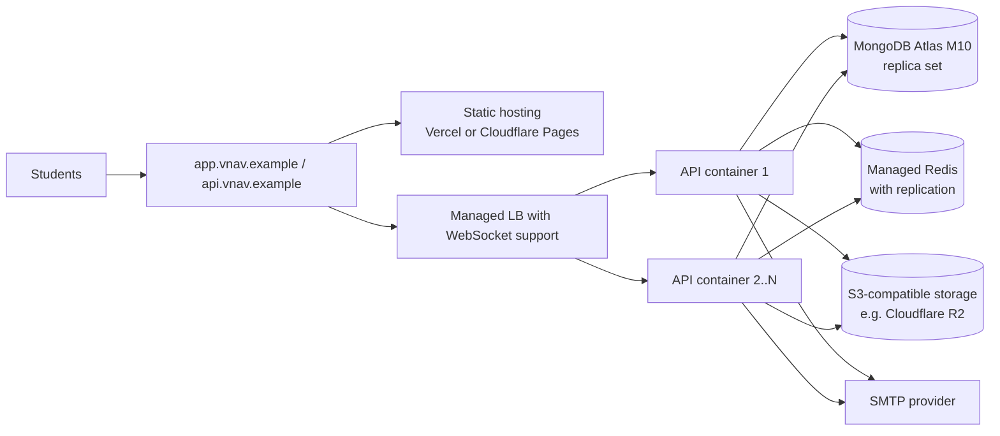

# V-Nav Deployment

Status: **Phase 1 plan.** Dockerfiles, Compose files and CI are created in Phase 2 (local stack) and Phase 9 (production). Commands below become real as those phases land; DEVELOPMENT_PROGRESS.md tracks which exist.

---

## 1. Environments

| Environment | Purpose | Data |
|---|---|---|
| Local (Docker Compose) | Development, integration tests, multi-instance tests | Throwaway |
| CI (GitHub Actions) | Lint, type-check, unit + integration + socket tests, build images | Service containers, throwaway |
| Staging | Pre-release verification, load tests | Seeded test users only |
| Production | VIT Chennai students | Real |

---

## 2. Local stack (Phase 2)

`docker-compose.yml` services (**implemented in Phase 2**). All ports bind to `127.0.0.1` only; the local services have no passwords.

| Service | Image | Host port | Notes |
|---|---|---|---|
| `mongo` | `mongo:7` | **27018** | `--replSet rs0`; the healthcheck runs `rs.initiate()` on first boot (transactions need a replica set). The member advertises `mongo:27017`, so host processes connect with `?directConnection=true`. Port 27018 avoids clashing with a locally installed MongoDB. |
| `redis` | `redis:7-alpine` | **6380** | No persistence (ephemeral by design). Port 6380 avoids clashing with another local Redis. |
| `mailpit` | `axllent/mailpit:v1.21` | 1025 (SMTP), 8025 (inbox) | Read OTP and reset emails at http://localhost:8025 |
| `api` | built from `server/Dockerfile` | 3000 | Only with `--profile api`; normally run the API on the host for fast reloads |

Commands:
```bash
docker compose up -d mongo redis mailpit
```
```bash
cp server/.env.example server/.env
```
Then replace the three `replace-with-…` secrets (the server refuses to start with the placeholders):
```bash
node -e "console.log(require('crypto').randomBytes(48).toString('base64url'))"
```
```bash
npm --prefix server install
```
```bash
npm --prefix server run dev
```
```bash
npm --prefix server test
```
```bash
docker compose --profile api up -d --build
```

`docker-compose.multi.yml` (**implemented in Phase 4**): two API instances (`api1`, `api2`) behind Nginx on http://localhost:8080 (`ops/nginx/multi.conf`), for cross-instance Socket.IO and failover tests:
```bash
docker compose -f docker-compose.yml -f docker-compose.multi.yml up -d --build
```
```bash
docker compose -f docker-compose.yml -f docker-compose.multi.yml stop api2
```
The second command shows graceful failover: `api2`'s sockets receive `server:shutdown`, reconnect through Nginx to `api1`, and `api2` exits with code 0. Load-balancer requirements this exposed (apply to any production LB): WebSocket upgrades allowed; balance by open connections (`least_conn`), not request count; share balancing state across workers (Nginx `zone`); a short upstream connect timeout with fail-over to the next instance, or active health checks on `/ready`; idle timeout above the 25 s Socket.IO ping interval.

---

## 3. Production architecture



**Same-site requirement:** the refresh cookie uses `SameSite=Lax`, so the SPA and API must share a registrable domain (`app.vnav.example` and `api.vnav.example`). The current setup (`*.vercel.app` + `*.up.railway.app`) is **cross-site**; it would force `SameSite=None` cookies and weaker CSRF posture. A custom domain is required for production.

Host options for the API (any container platform with WebSockets and ≥ 2 instances works):

| Option | Pros | Cons |
|---|---|---|
| Railway (current) | Already used, simple, managed Redis available | Check multi-replica + WebSocket LB behaviour in staging |
| Fly.io / Render | Multi-instance, WebSockets, health checks | New account |
| Single VM + Docker Compose + Nginx | Full control, cheapest at this scale | You run TLS, updates, backups |

Recommendation is finalised in Phase 9 after staging tests; nothing in the code depends on the host.

### MongoDB Atlas
- M10 or higher for production (M0 free tier has throughput and connection limits unsuitable for 500 sockets; fine for staging).
- Dedicated DB user with `readWrite` on `vnav` only; network access restricted to the API host's egress IPs (not `0.0.0.0/0` as in the current README).
- Continuous backups enabled.

### Release process
1. CI on PR: lint, type-check, tests, `npm audit`, gitleaks, image build.
2. Merge to `main` → build and push image tagged with commit SHA → deploy to staging → smoke tests.
3. Manual approval → production rolling deploy; `/ready` gates traffic; graceful shutdown drains old instances. Shutdown order: `/ready` → 503, stop accepting connections, tell sockets to reconnect and close them, drain HTTP (max 6 s), close Redis and MongoDB, exit 0; forced exit after 9 s, inside the usual 10 s grace period before SIGKILL.
4. `npm run db:indexes` runs as a release step before new code takes traffic (index builds are backward compatible).
5. Rollback = redeploy previous image tag.

---

## 4. Environment variables

Placeholders only; real values live in the host's secret manager.

### Server
| Variable | Example | Required |
|---|---|---|
| `NODE_ENV` | `production` | yes |
| `PORT` | `3000` | yes |
| `TRUST_PROXY` | `1` (number of reverse-proxy hops; `0` locally) | no, default `0` |
| `CLIENT_ORIGINS` | `https://app.vnav.example` (comma-separated) | yes |
| `MONGO_URI` | `mongodb+srv://<user>:<pass>@<cluster>/vnav` | yes |
| `MONGO_POOL_SIZE` | `20` | no |
| `COOKIE_SECURE` | `true` (startup fails if `false` in production) | no, default `true` |
| `REDIS_URL` | `rediss://:<pass>@<host>:6379` | yes |
| `JWT_ACCESS_SECRET` | ≥ 32 random bytes, base64 | yes |
| `OTP_SECRET` | ≥ 32 random bytes | yes |
| `IP_HASH_SECRET` | ≥ 32 random bytes | yes |
| `ALLOWED_EMAIL_DOMAINS` | `vitstudent.ac.in` | yes |
| `SMTP_HOST`, `SMTP_PORT`, `SMTP_SECURE`, `SMTP_USER`, `SMTP_PASS`, `MAIL_FROM` | provider values | yes (user/pass optional) |
| `APP_PUBLIC_URL` | `https://app.vnav.example` (links in emails) | yes |
| `CAMPUS_BOUNDARY_FILE` | path to campus polygon GeoJSON (default `data/campus-boundary.geojson`, shipped in the image) | no |
| `INSTANCE_ID` | label for this replica (default hostname:pid) | no |
| `STORAGE_DRIVER` | `local` \| `s3` | yes |
| `S3_ENDPOINT`, `S3_BUCKET`, `S3_ACCESS_KEY_ID`, `S3_SECRET_ACCESS_KEY`, `S3_PUBLIC_URL` | provider values | if `s3` |
| `LOG_LEVEL` | `info` | no |
| `METRICS_TOKEN` | random | no |
| `OTEL_EXPORTER_OTLP_ENDPOINT` | collector URL | no (tracing off when unset) |
| `SENTRY_DSN` | DSN | no (error reporting off when unset) |

### Client
| Variable | Example |
|---|---|
| `VITE_API_URL` | `https://api.vnav.example` |
| `VITE_SOCKET_URL` | `https://api.vnav.example` |
| `VITE_MAPBOX_TOKEN` | URL-restricted `pk.` token |
| `VITE_APP_SHELL` | `next` selects the rebuilt app. Set by `client/.env.next` (Vite mode `next`: `npm run dev:next`, `npm run build:next`). Removed in Phase 7, when the rebuilt app becomes the only one. |

---

## 5. Monitoring (Phase 9 detail)
- Logs: JSON to stdout → host log drain. Fields: `time, level, msg, requestId, userId, route, status, durationMs`.
- Metrics: `/metrics` scraped by Prometheus (or Grafana Cloud agent). Key series: `http_request_duration_seconds`, `socketio_connected_clients`, `location_updates_total{result}`, `location_fanout_recipients`, `mongo_command_duration_seconds`, `redis_command_errors_total`.
- Dashboards: a Grafana dashboard JSON committed under `ops/grafana/`.
- Alerts: `/ready` failing, 5xx rate > 1 % for 5 min, p95 > SLO for 10 min, socket count drop > 50 % in 1 min, Redis errors.
- Tracing: OpenTelemetry Node SDK, enabled only when `OTEL_EXPORTER_OTLP_ENDPOINT` is set.
- Errors: Sentry (or compatible) when `SENTRY_DSN` is set, with PII scrubbing matching the log redaction list.
